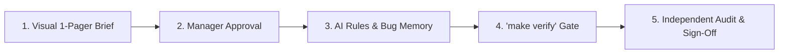

# Vibe Manager (`vibe-manager`)

An **Engineering Manager (EM) & Tech Lead** skill for orchestrating AI coding agents across any domain (**Web**, **Backend**, **Blockchain**, **SystemC/Hardware**, **Embedded C/C++**, **Data/ML**).

Skip reading raw code and PR diffs—manage agents through **1-page visual blueprints**, **automated quality gates (`make verify`)**, and **independent subagent audits**.

## Workflow



1. **Visual 1-Pager Brief**: Generates a plain-English domain primer, Mermaid flow diagram, Input/Output contract table, stack/health audit, and top 3–5 risks.
2. **Manager Approval Gate**: Pauses before coding until you approve the brief and key trade-offs.
3. **AI Guardrails & Memory**: Enforces architectural pushback, pre-mortem edge cases, zero test-cheating, and persistent outage memory (`docs/em/LESSONS.md`).
4. **Automated Verification (`make verify`)**: Sets up compilers/type-checkers, linters, tests, and CI before feature work (using a non-destructive ratchet strategy on existing repos).
5. **Maker-Checker Sign-Off**: Audits code with a fresh Reviewer Subagent and delivers a 1-page Sign-Off Report.

## Installation

```bash
# Global install (all workspaces)
mkdir -p ~/.gemini/config/skills
cp -R . ~/.gemini/config/skills/vibe-manager
```

## Usage

- **New Project**: *"Use `vibe-manager` to design and build [project idea]."*
- **Existing Repo**: *"Use `vibe-manager` to onboard me onto this repo and plan [feature/fix]."*
