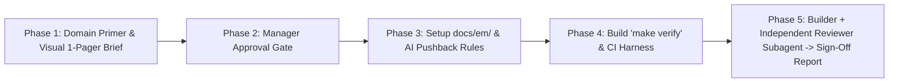

# Vibe Manager (`vibe-manager`)

An **Engineering Manager (EM) & Tech Lead** orchestration skill for AI coding agents across any programming domain (**Web**, **Backend/Distributed Systems**, **Blockchain/Smart Contracts**, **SystemC/Hardware Modeling**, **Embedded C/C++**, and **Data/ML**).

Instead of reviewing thousands of lines of AI-generated code or raw PR diffs, **Vibe Manager** shifts your role upstream (approving visual 1-page blueprints, input/output contracts, and high-level risks) and downstream (enforcing `make verify` quality gates and independent Reviewer Subagent audits).

---

## 5-Phase Workflow



1. **Phase 1 — Domain Research & Visual 1-Pager Brief (`resources/BRIEF_TEMPLATE.md`)**
   - Supports both **New Projects (Greenfield)** and **Old Workspaces (Brownfield Onboarding & Health Audit)**.
   - Produces a plain-English **Domain Mental Model**, **Mermaid Architecture Flow**, **Strict Input/Output Contract Table**, **Tech Stack & Guardrail Audit**, and **Top 3–5 High-Level Risks/Decisions**.
2. **Phase 2 — Manager Approval Gate**
   - Stops before any feature code is written until the Manager approves the Brief and resolves key trade-offs.
3. **Phase 3 — Institutional Memory & Anti-Blind-AI Rules**
   - Initializes `docs/em/BRIEF.md` and `docs/em/LESSONS.md` (`resources/LESSONS_TEMPLATE.md`) so agents remember past outages and bugs across sessions.
   - Installs `.agents/rules/em-guardrails.md` (`resources/AGENT_RULES_TEMPLATE.md`) enforcing:
     - **Rule 1**: Feel the pain of bad architecture and push back before coding.
     - **Rule 2**: Read and update `docs/em/LESSONS.md` after every bug/outage.
     - **Rule 3**: Write a Pre-Mortem Edge-Case Table (minimum 5 edge cases) before coding.
     - **Rule 4**: Zero reward-hacking (never skip/delete tests or hardcode fake outputs).
4. **Phase 4 — Automated Verification Harness (`make verify`)**
   - Sets up domain-adaptive compilers/type-checkers, linters, automated I/O testbenches, coverage gates, and CI workflows (`references/DOMAIN_HARNESS_MATRIX.md`).
   - Uses a non-destructive **Ratchet Strategy** when adopted in legacy workspaces.
5. **Phase 5 — Builder + Independent Reviewer Subagent Loop**
   - Spawns an independent **Tech Lead Code Auditor** subagent (fresh context) to audit the diff for test-cheating and architectural drift before delivering a 1-page **Manager Sign-Off Report** (`resources/SIGN_OFF_REPORT_TEMPLATE.md`).

---

## Repository Structure

```text
vibe-manager/
├── README.md
├── SKILL.md                               # Main SOP & 5-Phase Orchestration Workflow
├── resources/
│   ├── BRIEF_TEMPLATE.md                  # Visual 1-Pager Brief template
│   ├── AGENT_RULES_TEMPLATE.md            # Anti-Blind-AI behavioral rules
│   ├── LESSONS_TEMPLATE.md                # Living Post-Mortem & Outage Memory template
│   └── SIGN_OFF_REPORT_TEMPLATE.md        # Manager Sign-Off Report (replaces raw PR review)
└── references/
    └── DOMAIN_HARNESS_MATRIX.md           # Cross-domain stacks, static analyzers, test runners & risks
```

---

## Installation

### Global Installation (All Workspaces)
Copy or symlink into your global skills directory:

```bash
mkdir -p ~/.gemini/config/skills
cp -R . ~/.gemini/config/skills/vibe-manager
```

### Project-Local Installation
Copy into a project's `.agents/skills/` folder:

```bash
mkdir -p .agents/skills
cp -R . .agents/skills/vibe-manager
```

---

## Usage

In any new or existing workspace, prompt your agent:

- **New Project**: *"Use `vibe-manager` to design and build [your project idea]."*
- **Existing / Legacy Workspace**: *"Use `vibe-manager` to onboard me onto this repo and plan [new feature or fix]."*
