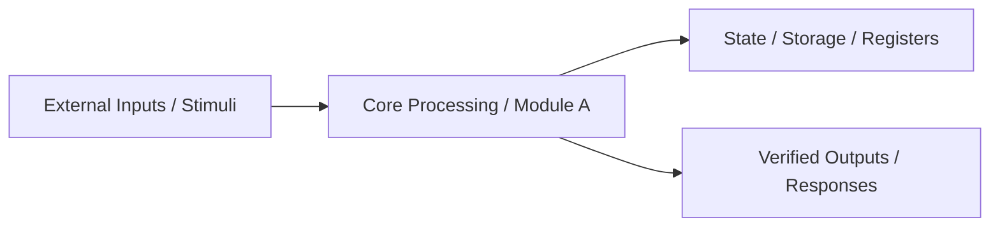

# Executive Engineering Brief: <Project / Feature Name>

> **Status**: `DRAFT (Awaiting Manager Approval)` | `APPROVED`
> **Domain**: `<e.g., Web App / Smart Contracts / SystemC TLM-2.0 / Distributed Backend>`
> **Last Updated**: `<YYYY-MM-DD>`

---

## 1. Domain Mental Model (General Knowledge)

*A concise plain-English primer on how this field operates and what matters most:*
- **Core Concept**: `<How the system works at a fundamental level in 1-2 sentences>`
- **Execution Model**: `<e.g., Event-driven discrete-event simulation (SystemC) / Deterministic EVM state transitions (Blockchain) / Stateless HTTP + ACID DB (Web)>`
- **Key Terminology**:
  - `<Term 1>`: `<Plain-English definition>`
  - `<Term 2>`: `<Plain-English definition>`
  - `<Term 3>`: `<Plain-English definition>`

---

## 2. High-Level Architecture & Flow

### Module Boundaries
- **`<Module 1>`**: `<Single responsibility in 1 line>`
- **`<Module 2>`**: `<Single responsibility in 1 line>`
- **`<Module 3>`**: `<Single responsibility in 1 line>`

---

## 3. Strict Input / Output Contracts

| Direction | Name / Signal / Endpoint | Format & Type | Validation / Constraints | Error / Edge Behavior |
| :--- | :--- | :--- | :--- | :--- |
| **IN** | `<e.g., clk / POST /orders>` | `<e.g., sc_in<bool> / JSON>` | `<e.g., Positive edge / Auth + Schema>` | `<e.g., Ignore / HTTP 400>` |
| **IN** | `<Input 2>` | `<Type>` | `<Constraints>` | `<Failure mode>` |
| **OUT** | `<e.g., irq_out / OrderReceipt>` | `<e.g., sc_out<uint32> / JSON>` | `<e.g., Assert within 2 cycles / 200 OK>` | `<e.g., Timeout flag / 500>` |

---

## 4. Tech Stack & Guardrail Health Audit

| Layer | Detected / Recommended Choice | Current Status (Old Repo) | 1-Line Why (Manager Justification) |
| :--- | :--- | :--- | :--- |
| **Core Language / Runtime** | `<Choice>` | `<EXISTING / NEW>` | `<Why it fits performance, safety, and ecosystem needs>` |
| **Framework / Modeling Lib** | `<Choice>` | `<EXISTING / NEW>` | `<Why it reduces boilerplate or architectural risk>` |
| **Linter & Static Analysis** | `<Choice>` | `<PASS / MISSING / BROKEN>` | `<Catches type, memory, or security bugs before runtime>` |
| **Testing & QA Harness** | `<Choice>` | `<PASS / MISSING / BROKEN>` | `<Validates I/O contracts and edge cases automatically>` |
| **CI & Staging / Simulation** | `<Choice>` | `<PASS / MISSING / BROKEN>` | `<Reproducible environment before production release>` |

---

## 5. Important High-Level Points (Top Risks & Manager Decisions)

> [!IMPORTANT]
> As Engineering Manager, you do not need to review low-level syntax, but you **must** care about and decide on these high-level trade-offs:

1. **Risk / Decision 1 — `<Title, e.g., Cycle Accuracy vs. Simulation Speed>`**
   - **Impact**: `<What goes wrong if we get this wrong>`
   - **Recommendation**: `<Recommended approach and why>`
2. **Risk / Decision 2 — `<Title, e.g., State Concurrency / Reentrancy / Memory Ownership>`**
   - **Impact**: `<What goes wrong if we get this wrong>`
   - **Recommendation**: `<Recommended approach and why>`
3. **Risk / Decision 3 — `<Title, e.g., External Dependency / Failure Recovery>`**
   - **Impact**: `<What goes wrong if we get this wrong>`
   - **Recommendation**: `<Recommended approach and why>`

---

## 6. Automated Guardrails & Staging Plan

- **Single Verification Command**: `make verify` (or `./scripts/verify.sh`)
- **Static & Lint Gates**: `<e.g., clang-tidy + -Wall -Werror / tsc --noEmit + eslint / slither>`
- **Automated Test & Coverage Requirement**: `<e.g., >= 85% line/branch coverage + 100% I/O contract assertion pass>`
- **Staging / Simulation Environment**: `<How the full system runs end-to-end before sign-off>`
