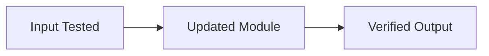

# Manager Sign-Off Report: <Feature / Milestone Name>

> **Overall Status**: `READY FOR SIGN-OFF` | `BLOCKED`
> **Independent Reviewer Verdict**: `PASS` (Audited by Tech Lead Reviewer Subagent)

---

## 1. High-Level Summary (What Changed)

- **Objective**: `<1-sentence summary of the capability delivered>`
- **Architectural Impact**: `<Which modules were added/updated—no low-level code dump>`

---

## 2. Input / Output Verification Proof

| Input / Scenario | Expected Output | Observed Result | Automated Test Reference |
| :--- | :--- | :--- | :--- |
| `<Happy Path Input>` | `<Expected Output>` | `PASS` | `[test_file#Lxx](file:///absolute/path#Lxx)` |
| `<Edge Case 1: Boundary/Zero>` | `<Expected Handling>` | `PASS` | `[test_file#Lxx](file:///absolute/path#Lxx)` |
| `<Edge Case 2: Invalid/Malformed>` | `<Expected Rejection>` | `PASS` | `[test_file#Lxx](file:///absolute/path#Lxx)` |
| `<Edge Case 3: Overflow/Limit>` | `<Expected Handling>` | `PASS` | `[test_file#Lxx](file:///absolute/path#Lxx)` |
| `<Edge Case 4: Timing/Concurrency>` | `<Expected Handling>` | `PASS` | `[test_file#Lxx](file:///absolute/path#Lxx)` |
| `<Edge Case 5: Dependency Failure>` | `<Expected Recovery>` | `PASS` | `[test_file#Lxx](file:///absolute/path#Lxx)` |

---

## 3. Automated Quality Gate Metrics (`make verify`)

| Check | Tool Used | Result | Details |
| :--- | :--- | :--- | :--- |
| **Compiler / Type Check** | `<e.g., tsc / g++ -Werror>` | `PASS (0 errors)` | Strict mode enabled |
| **Linter & Static Analysis** | `<e.g., eslint / clang-tidy / slither>` | `PASS (0 warnings)` | No suppressed rules |
| **Automated Test Suite** | `<e.g., vitest / pytest / ctest / forge>` | `PASS (X/X passed)` | Execution time: `<Xs>` |
| **Test Coverage** | `<Coverage Tool>` | `<XX%>` | Target: `>= 80%` |

---

## 4. Independent Tech Lead Subagent Audit

- **Reward-Hacking Check**: `CLEAN` (No skipped tests, weakened assertions, or hardcoded mocks)
- **Architecture Alignment**: `CLEAN` (Conforms to `docs/em/BRIEF.md` module boundaries)
- **Lessons Logged**: `<New entry added to docs/em/LESSONS.md, or "None required">`
- **Residual Risks / Follow-ups for Manager**: `<Any high-level trade-off or next step for the Manager>`
